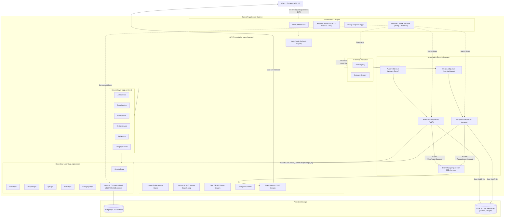
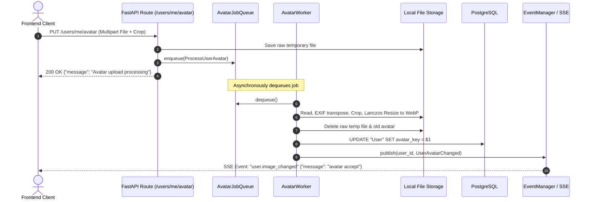
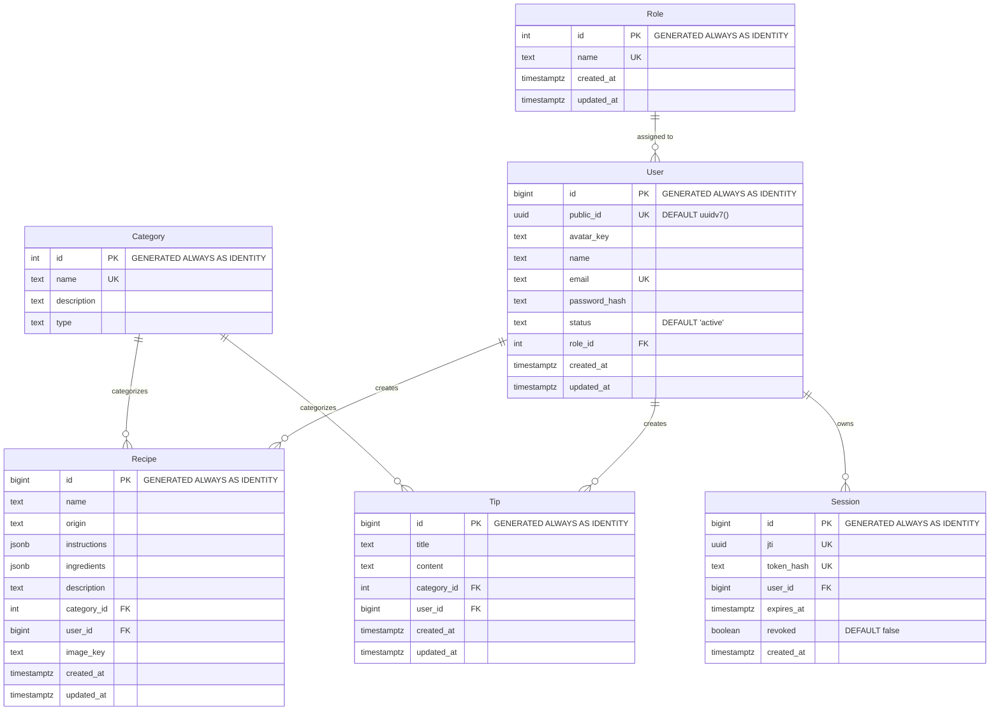
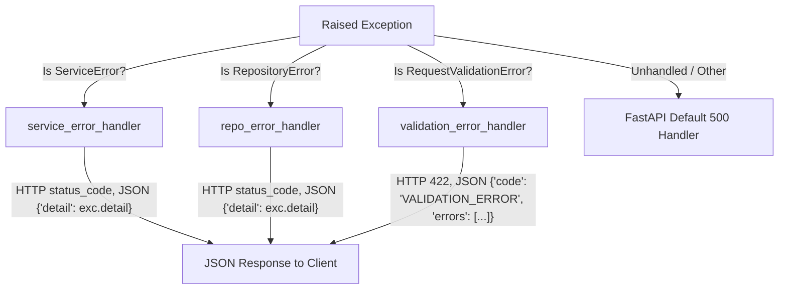

# NutriUC Backend - Architecture Documentation

## Table of Contents

- [1. Overview](#1-overview)
- [2. Architectural Principles](#2-architectural-principles)
- [3. System Architecture Diagram](#3-system-architecture-diagram)
- [4. Layered Architecture Breakdown](#4-layered-architecture-breakdown)
  - [4.1 Presentation / API Layer (`app.api`)](#41-presentation--api-layer-appapi)
  - [4.2 Service Layer (`app.services`)](#42-service-layer-appservices)
  - [4.3 Repository / Data Access Layer (`app.repositories`)](#43-repository--data-access-layer-apprepositories)
  - [4.4 Domain & Data Models (`app.models`)](#44-domain--data-models-appmodels)
  - [4.5 Core & Cross-Cutting Infrastructure (`app.core`)](#45-core--cross-cutting-infrastructure-appcore)
- [5. Asynchronous Background Workers & Job Queues](#5-asynchronous-background-workers--job-queues)
- [6. Real-Time Communication (Server-Sent Events)](#6-real-time-communication-server-sent-events)
- [7. Authentication & Session Management](#7-authentication--session-management)
- [8. In-Memory Registry Pattern](#8-in-memory-registry-pattern)
- [9. Database & Storage Architecture](#9-database--storage-architecture)
  - [9.1 Schema Design](#91-schema-design)
  - [9.2 Cursor-Based Keyset Pagination](#92-cursor-based-keyset-pagination)
  - [9.3 Zero-ORM Direct SQL Philosophy](#93-zero-orm-direct-sql-philosophy)
- [10. Observability & Multi-Layer Tracing](#10-observability--multi-layer-tracing)
- [11. Error Handling Strategy](#11-error-handling-strategy)
- [12. Scalability & Extensibility Roadmap](#12-scalability--extensibility-roadmap)

---

## 1. Overview

**NutriUC Backend** is the core RESTful and real-time backend API for the *Web Saludable UC* nutrition platform. Built using **Python 3.14+** and **FastAPI**, it provides high-throughput, low-latency endpoints for user authentication, recipe management, dietary tips, and profile media processing.

The system combines:
- **Layered Clean Architecture** (API &rarr; Service &rarr; Repository &rarr; Database) with strict dependency boundaries.
- **Asynchronous I/O** powered by `asyncpg` native PostgreSQL driver without Object-Relational Mapping (ORM) overhead.
- **Event-Driven Asynchronous Job Workers** for non-blocking media cropping and WebP transcoding.
- **Server-Sent Events (SSE)** for unidirectional real-time event streaming to connected clients.

---

## 2. Architectural Principles

1. **Separation of Concerns (SoC):** HTTP routing and serialization reside strictly in the API layer; business rules and transaction orchestration reside in the Service layer; SQL statements and persistence logic are isolated within the Repository layer.
2. **Zero-ORM Direct SQL:** Queries are written in native, parameterized PostgreSQL SQL using `asyncpg`. This avoids ORM overhead, eliminates the N+1 query problem, maximizes query predictability, and utilizes PostgreSQL native features (e.g., UUIDv7, JSONB type codecs, `OVERRIDING SYSTEM VALUE`).
3. **Decoupled Heavy Computation:** CPU-bound operations (such as image EXIF correction, square cropping, and Lanczos WebP conversion) are handed off to in-memory queues and background workers to keep HTTP request-response cycles sub-millisecond.
4. **Push-Based Reactive Feedback:** Instead of client polling, long-running background operations push their completion or rejection statuses via Server-Sent Events (SSE).
5. **Fail-Fast & Explicit Errors:** Custom hierarchy of domain exceptions (`ServiceError`, `RepositoryError`) transformed into standard HTTP JSON error structures via centralized exception handlers.
6. **Pre-warmed Read-Only Registries:** Frequently accessed, low-mutability domain entities (Roles, Categories) are cached in memory on application startup (`RoleRegistry`, `CategoryRegistry`) to avoid unnecessary database joins and lookups.

---

## 3. System Architecture Diagram

---

## 4. Layered Architecture Breakdown

The code is strictly organized in a four-tier architecture plus cross-cutting infrastructure modules under `src/app`:

### 4.1 Presentation / API Layer (`app.api`)
- **Routers (`app.api.routes`)**: Route declarations with route-level metadata, tags, and expected OpenAPI responses. Routes do not execute business logic; they validate input DTOs, extract dependencies, delegate to services, and return responses.
- **Dependencies (`app.api.dependencies`)**:
  - `get_db`: Yields an active `asyncpg.Connection` acquired from the pool.
  - `get_profile`: Extracts and validates the access token from the `access_token` cookie, asserting authenticated state.
  - `get_profile_optional`: Permits anonymous access while extracting identity if a valid cookie is present (used for filtering `"mine"` in recipes/tips).
  - `get_role_registry` & `get_category_registry`: Injects startup cached dictionaries.
- **Schemas / DTOs (`app.api.schemas`)**: Pydantic models for request bodies, query parameters, and output contracts. Includes:
  - `CursorPage[T]`: Generic wrapper for keyset pagination results with `items`, `next_cursor`, `prev_cursor`, and `has_more`.
  - Input DTOs with validation rules (e.g. recipe instruction steps, ingredient lists, crop coordinates).
- **Responses (`app.api.responses`)**: Uniform JSON responses (`MessageResponse`, `MessageError`, `ErrorResponse`) and standard OpenAPI response map definitions.

### 4.2 Service Layer (`app.services`)
- Houses domain orchestration and business logic.
- Services never interact with HTTP request or response objects directly; they receive parsed models and connection handles.
- **Responsibilities**:
  - Password verification using Argon2.
  - Generating dual JWT tokens (Access + Refresh) and orchestrating refresh token hashing for session records.
  - Revoking sessions upon logout.
  - Enforcing authorization constraints (e.g., verifying user ownership before modifying recipes/tips).
  - Throwing typed `ServiceError` subclasses when business invariant rules fail.

### 4.3 Repository / Data Access Layer (`app.repositories`)
- Pure data access methods executing raw SQL against PostgreSQL via `asyncpg`.
- **Query Logging & Monitoring**: Integrates with `@trace(TraceLayer.REPO)` and optional SQL statement duration logging.
- **Connection Management (`app.repositories.connection`)**: Maintains an asynchronous connection pool (`asyncpg.create_pool`), configuring custom JSON/JSONB encoders and decoders.
- **Explicit Parameter Binding**: All SQL parameters use positional `$1, $2, ...` syntax, eliminating SQL injection risks.

### 4.4 Domain & Data Models (`app.models`)
- Internal representations (`UserDB`, `RecipeDB`, `SessionDB`, `TipDB`, `Role`, `Category`).
- Enums defining domain statuses (`UserStatus`: active, inactive, banned) and pagination directions (`CursorDirection`: next, prev).

### 4.5 Core & Cross-Cutting Infrastructure (`app.core`)
- **`config.py`**: Pydantic Settings reading environment variables, validating database URLs and strict production CORS restrictions.
- **`cookies.py`**: Hardened cookie configuration (`HttpOnly`, `SameSite=Lax/Strict`, conditional `Secure` flag for production).
- **`logger.py`**: Terminal colored formatter (`ColorFormatter`) providing structured log output.
- **`decorator.py`**: Provides the `@trace(layer)` aspect decorator.
- **`middleware/`**:
  - `time_log_requests`: Records request latency and injects `X-Process-Time` response header.
  - `debug_request`: Logs request headers, cookies, and body when `TRACE_LAYERS` includes `"api"`.
  - `exceptions.py`: Intercepts `ServiceError`, `RepositoryError`, and `RequestValidationError`, converting them to standardized client-friendly JSON.

---

## 5. Asynchronous Background Workers & Job Queues

Image uploads (profile avatars and recipe covers) involve format validation, aspect-ratio cropping, downsampling, and conversion to modern compressed formats (WebP). Performing these tasks inside the HTTP request loop blocks worker threads and degrades throughput.

### Queue Architecture

1. **Job Queues (`app.core.queue`)**:
   - `AvatarJobQueue`: In-memory `asyncio.Queue[ProcessUserAvatar]`.
   - `RecipeJobQueue`: In-memory `asyncio.Queue[ProcessRecipeImage]`.
2. **Job Contract (`app.jobs`)**:
   - Encapsulates job type (`user.image_changed`, `recipe.image_changed`) and immutable payload data (file paths, crop coordinates, IDs).
3. **Workers (`app.core.workers`)**:
   - `AvatarWorker`:
     - Reads temporary uploaded image.
     - Automatically applies EXIF orientation normalization (`ImageOps.exif_transpose`).
     - Crops image using normalized fractional coordinates `(x, y, size)`.
     - Resizes to standard dimension (`512x512`) using `Resampling.LANCZOS`.
     - Saves as WebP format to `RESOURCES_DIR/avatars/{avatar_key}.webp`.
     - Deletes previous avatar file from disk if present.
     - Updates `User.avatar_key` in the database.
     - Dispatches real-time SSE event to notify the user.
   - `RecipeWorker`:
     - Verifies image integrity.
     - Converts to RGB and resizes to `800x800` WebP format.
     - Saves to `RESOURCES_DIR/recipes/{image_key}.webp`.
     - Updates `Recipe.image_key` in the database.
     - Dispatches real-time SSE event.
4. **Lifecycle Integration (`app.context_manager`)**:
   - Workers run as background `asyncio.Task` instances started during FastAPI `lifespan`.
   - On shutdown, worker tasks are cleanly cancelled and drained before closing the database pool.

---

## 6. Real-Time Communication (Server-Sent Events)

The application utilizes **Server-Sent Events (SSE)** via `sse-starlette` to establish a persistent unidirectional real-time channel between backend and client.

- **Endpoint**: `GET /api/v1/events/events` (protected by `get_profile` authentication).
- **Manager (`app.core.events.manager.EventManager`)**:
  - Maintains an active dictionary mapping `user_id` to a set of `asyncio.Queue` instances.
  - Supports multiple concurrent tabs/devices for the same authenticated user.
  - Automatically cleans up disconnected queues when the client connection terminates.
- **Events Dispatched**:
  - `connected`: Emitted upon connection establishment.
  - `user.image_changed`: Emitted when avatar processing finishes successfully.
  - `user.image_rejected`: Emitted if avatar validation or format checks fail.
  - `recipe.image_changed`: Emitted when recipe image processing finishes.
  - `recipe.image_rejected`: Emitted if recipe image processing fails.

---

## 7. Authentication & Session Management

NutriUC implements a stateful dual-token authentication scheme leveraging secure cookies and database-backed session tracking.

### Token Architecture
- **Access Token (JWT)**:
  - Short-lived token stored in an `HttpOnly`, `SameSite=Lax` cookie (`access_token`).
  - Contains subject (`sub`: user ID) and expiration (`exp`).
  - Verified on every authenticated request via `get_profile`.
- **Refresh Token (JWT + Database Session)**:
  - Long-lived token stored in an `HttpOnly`, `SameSite=Strict` cookie (`refresh_token`).
  - Contains a unique JWT ID (`jti`) and user ID (`sub`).
  - The token is cryptographically hashed with SHA-256 before persisting in the `"Session"` database table.
  - Storing only the SHA-256 hash ensures that even in the event of a database compromise, valid refresh tokens cannot be forged or extracted.

### Session Revocation & Rotation
- **Refresh Flow (`POST /api/v1/auth/refresh`)**:
  - Validates refresh token signature and claims.
  - Queries `"Session"` by `jti`.
  - Checks if the session is revoked or expired.
  - Issues a new access token while preserving or rotating sessions.
- **Logout Flow (`POST /api/v1/auth/logout`)**:
  - Marks the session in the database as `revoked = true`.
  - Clears both `access_token` and `refresh_token` cookies.

### Password Security
- Passwords are encrypted using **Argon2id** via `pwdlib[argon2]`, conforming to current OWASP cryptographic recommendations.

---

## 8. In-Memory Registry Pattern

To eliminate repetitive and costly database queries for static lookup data, NutriUC uses an in-memory **Registry Pattern**:

- **Registries**:
  - `RoleRegistry`: Maps role names (e.g., `admin`, `user`) to primary key IDs.
  - `CategoryRegistry`: Stores category names, descriptions, and types (`recipes`, `tips`).
- **Initialization**:
  - On application startup (`app.context_manager.lifespan`), the backend queries the `"Role"` and `"Category"` tables once.
  - Caches instances into `app.state.role_registry` and `app.state.category_registry`.
- **Injection**:
  - Injected into route handlers via FastAPI dependencies (`get_role_registry`, `get_category_registry`).
  - Guarantees `O(1)` in-memory lookup without database roundtrips.

---

## 9. Database & Storage Architecture

### 9.1 Schema Design

The schema is defined in `database/init.sql` for PostgreSQL 18:

### 9.2 Cursor-Based Keyset Pagination

For listing recipes and tips (`/recipes/search`, `/tips/search`), NutriUC eschews traditional `OFFSET / LIMIT` pagination in favor of **Keyset (Cursor-Based) Pagination**:

- **Why Keyset Pagination?**
  - High Performance: `OFFSET 10000` requires PostgreSQL to scan and discard 10,000 rows. Keyset pagination uses indexed B-tree comparisons (`WHERE id < $cursor` or `WHERE id > $cursor`), providing consistent $O(\log N)$ retrieval regardless of table depth.
  - Consistency: Avoids duplicate or missed items caused by real-time insertions or deletions during client pagination.
- **Implementation**:
  - Accepts `cursor` (record ID), `limit` (page size), and `direction` (`next` or `prev`).
  - Fetches `limit + 1` rows to determine `has_more` without issuing a secondary `COUNT(*)` query.
  - Automatically reverses and sorts results when traversing backwards (`direction=prev`).

### 9.3 Zero-ORM Direct SQL Philosophy

- Uses `asyncpg` directly for:
  - Minimal memory footprint and execution overhead.
  - Automatic JSON/JSONB serialization via `conn.set_type_codec`.
  - Complete control over SQL statements, execution plans, and transaction boundaries (`async with conn.transaction():`).

---

## 10. Observability & Multi-Layer Tracing

NutriUC includes a dedicated tracing and logging subsystem:

- **Configurable Layers (`TRACE_LAYERS`)**:
  Enables targeted tracing across layers without code modifications via the `.env` variable:
  - `"api"`: Dumps inbound request method, URL, headers, cookies, and payload.
  - `"service"`: Traces service method entry, arguments, and exit.
  - `"repo"`: Traces repository function calls and parameters.
  - `"db"`: Logs every raw SQL query and execution duration in milliseconds.
  - `"worker"`: Traces background queue processing jobs.
  - `"events"`: Traces SSE publish and dispatch events.
- **Decorator Implementation (`@trace(layer)`)**:
  - Wrapped around functions across layers.
  - Automatically filters out sensitive or bulky arguments (`conn`, `request`, `response`).
  - Logs unhandled exceptions with full stack traces before re-raising.
- **Latency Monitoring**:
  - Middleware measures end-to-end request latency and appends `X-Process-Time` to response headers.

---

## 11. Error Handling Strategy

Errors are treated as first-class domain concepts with strict categorization:

- **Domain Errors**:
  - `UserInvalidError`, `UserInvalidCredentialsError` &rarr; 400 Bad Request
  - `RecipeNotFoundError`, `TipNotFoundError` &rarr; 404 Not Found
  - `RecipeForbiddenError` &rarr; 403 Forbidden
  - `TokenInvalidError` &rarr; 401 Unauthorized
- **Validation Errors**:
  - Pydantic validation failures formatted into structured `{ field, code, message }` arrays.

---

## 12. Scalability & Extensibility Roadmap

While the current architecture is optimized for single-node deployments with low operational complexity, the decoupled design enables straightforward scaling:

1. **Distributed Task Queue**: Replace in-memory `asyncio.Queue` with Celery, Redis Streams, or RabbitMQ for multi-instance worker pools.
2. **Distributed Real-Time SSE**: Replace in-memory `EventManager` with a Redis Pub/Sub backplane to broadcast events across multiple load-balanced FastAPI instances.
3. **Cloud Object Storage**: Abstract local storage (`RESOURCES_DIR`) behind an S3-compatible interface (AWS S3, MinIO, Cloudflare R2) for media assets.
4. **Database Read Replicas**: Route read-only queries (`RecipeRepo.getDtoWithParams`) to read replicas while routing write operations to the primary PostgreSQL node.
